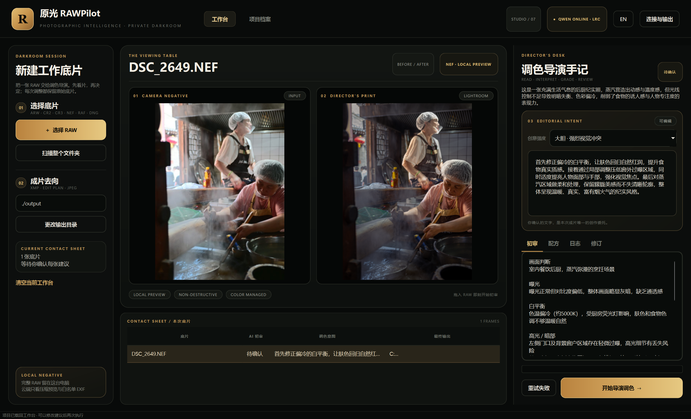
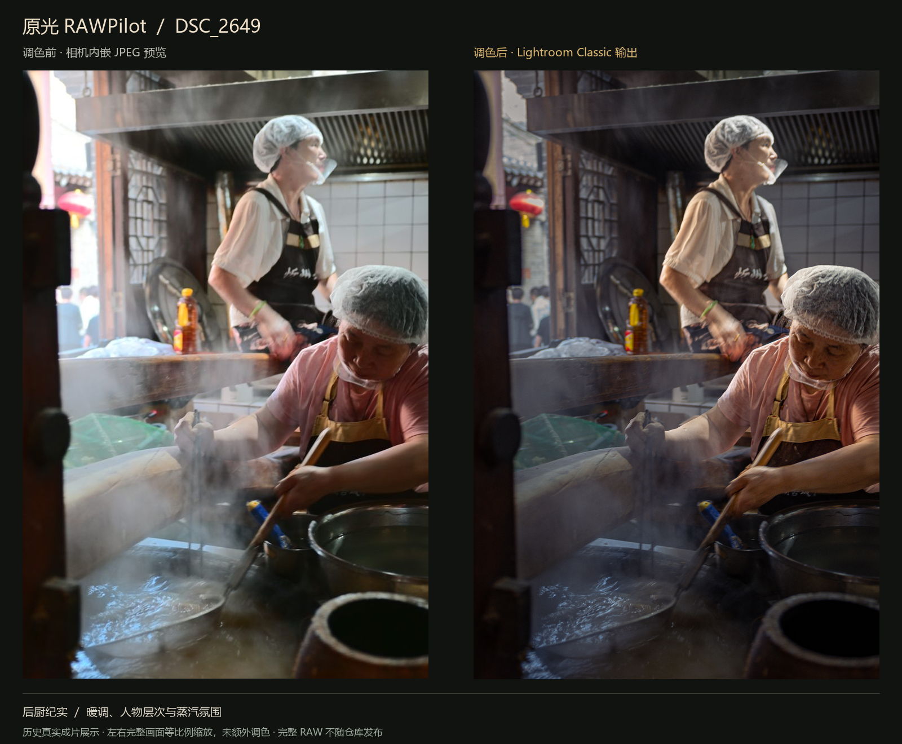

# 原光 RAWPilot

## 主界面



暗房工作台把 RAW 导入、可编辑的自然语言调色建议、输入／输出对照、诊断、配方和后续修订放在同一页。上图为当前本地桌面界面载回历史项目后的实际截图，待确认状态表示可继续修改建议并再次执行。

## 调色前后对比 · DSC_2649



后厨纪实案例的调色方向：修正白平衡、控制门口高光，调整人物与背景层次，并保留蒸汽的烟火气氛围。

左侧为从原始 NEF 重新提取的相机内嵌 JPEG 预览，右侧为 2026 年 7 月 24 日真实运行保存的 Lightroom Classic 输出。展示图仅统一排版与等比例缩放，未额外调色；相机预览自带相机处理，不等同于 Lightroom 零调整基准。

[查看展示素材说明](docs/SHOWCASE.md)。

Windows RAW 后期 Agent MVP。它在本机从 RAW 中提取内嵌 JPEG 预览和 EXIF，只把压缩预览与少量元数据发送给兼容 OpenAI `/chat/completions` 的 Qwen Vision/LLM API，并为每张原片生成同名 Adobe Camera Raw XMP sidecar。原片不会被修改，也不会上传完整 RAW。

> Privacy note: never commit API keys or private photographs. Local credentials live in `%APPDATA%\RAWPilot\.env`; RAW files, rendered JPEGs, XMP sidecars, build outputs, and local project state are excluded from this repository. Only the maintainer-selected, documented showcase images in `docs/images/` are published intentionally.

## 功能

- 导入单个或整个文件夹中的 ARW、CR2、CR3、NEF、RAF、DNG
- 支持从 Windows 资源管理器直接拖入单张、多张 RAW 或整个文件夹
- 导入后先做 AI 画面初审，并为每张底片生成可编辑的自然语言调色建议
- 批量任务、进度、逐项诊断、参数预览、日志与失败提示
- 严格、带范围校验的 `*.edit_plan.json`
- 同名 `*.xmp`，使用 ACR 2012/15.x 全局调整字段
- 本机项目档案：保存诊断、建议、最终提示词、参数和输出路径，可回看并载回工作台
- 工作台同页并排展示相机内嵌预览与 Lightroom 最终成片
- 导出后自动检查亮度分布；异常黑片会自动恢复曝光并重导，仍不合格则标记失败
- 按专业顺序规划：技术校正 → 全局基准 → 区域塑形 → 色彩关系 → 风格塑造 → 细节输出
- 默认保留相机 As Shot 白平衡；同时执行镜头配置、色差移除和完整锐化控制
- 在线模式会让视觉模型同时查看 BEFORE/AFTER，检查偏绿、光晕、鬼影强化、过锐化、灯光溢色和提示词匹配；最多自动返工两次
- 人物局部要求会映射为可自动执行的主体 AI 蒙版，不再被 Bridge 静默跳过
- Bridge 会记录自己创建的蒙版 ID；再次处理同一 RAW 时先替换上一组 RAWPilot 蒙版，避免效果重复叠加
- 成片后处理：根据用户对当前结果的反馈增量修订参数，并保留每次独立版本
- API Base URL、Key、视觉/语言模型设置与低 token 连接测试
- Mock API 离线流程（默认开启）
- 可选 Lightroom Classic Bridge：应用调色参数并导出 sRGB JPEG

## 开发运行

要求 Windows x64 与 Python 3.11。

```powershell
py -3.11 -m venv .venv
.\.venv\Scripts\python.exe -m pip install -r requirements.txt
.\.venv\Scripts\python.exe -m rawpilot
```

首次打开默认使用 Mock API。真实 API 模式在“设置”中填写：

- Base URL：`https://api-inference.modelscope.cn/v1`
- API Key：仅保存在 `%APPDATA%\RAWPilot\.env`
- 视觉模型：`Qwen/Qwen3.5-35B-A3B`
- 语言模型：`Qwen/Qwen3.5-35B-A3B`

同一个 Qwen3.5 多模态模型同时承担画面诊断和参数规划。视觉预览最长边限制为 1024px，模型关闭思考模式；自然语言建议与诊断在同一次视觉请求中返回，不额外消耗一次模型调用。

## 推荐工作流

1. 从 Windows 资源管理器把 RAW 直接拖到工作台，或使用左侧按钮导入一张 RAW / 整个文件夹。松开后会立即读取本地嵌入预览并进行 AI 初审。
2. 在右侧“调色导演建议”中阅读 Agent 针对当前照片生成的自然语言建议。
3. 在底部胶片条切换照片，逐张修改建议；每张底片拥有独立提示词。
4. 点击“开始导演调色”，生成受边界约束的 Lightroom 配方、XMP，并按设置决定是否调用 Lightroom Classic。
5. 成片返回后会与输入预览并排显示。RAWPilot 会先检查亮度分布，再由视觉模型核对成片是否符合提示词；主要意图明显偏离时自动返工一次。
6. 如果第一版不满意，打开“后处理”，输入“再暖一点、红色太艳、暗部更通透”等反馈，或使用快捷意见按钮。Agent 会在当前参数基础上增量修改。
7. 后处理版本输出到 `输出目录/revisions/照片名_时间/`，不会覆盖上一版，也不会重复创建已有 Lightroom AI 蒙版。
8. 每次执行都会写入“项目档案”。档案只保存路径和元数据，不复制 RAW，可载回工作台继续修改。

## Lightroom Classic 成片导出

在“连接与输出”中启用“调用本机 Lightroom Classic 调色并导出 JPEG”。保存时，RAWPilot 会把内置 Lua Bridge 安装到：

`%APPDATA%\Adobe\Lightroom\Modules\RAWPilot.lrplugin`

处理时仍会先生成 XMP 与 `edit_plan.json`，随后启动 Lightroom Classic。Bridge 将 RAW 添加到当前目录，并应用基础面板、HSL 色彩混合器、参数曲线、冷暖色彩分级、颗粒、暗角，以及按需生成的天空、主体和背景 AI 蒙版，最后在结果目录导出 90% 质量的 sRGB JPEG。局部要求互相冲突时（例如压暗天空同时提亮人物），规划器会让天空由 HSL 与天空蒙版承担，同时保护全局暗部，避免两组滑块互相抵消。

Lightroom 的“选择人物”会先要求用户在界面中选择具体人物，Classic SDK 不能无交互指定某一张脸。因此 RAWPilot 将人物局部要求映射为“选择主体”，再叠加全局暗部保护，实现全自动执行；多人画面仍建议在后处理页复核主体范围。

插件会在 Lightroom 启动时自动运行；首次安装或升级后，如果 Lightroom 已经打开，请完整退出并重启一次。可以在“文件 → 增效工具管理器”确认“原光 RAWPilot Bridge”处于“已安装并正在运行”。如果自动握手未出现，还可在“文件 → 增效工具 → 启动原光 RAWPilot Bridge”手动恢复。
RAWPilot 会校验 Bridge 版本握手。升级时如果 Lightroom 仍载入旧插件，当前任务会以兼容模式继续，不再直接失败；Lightroom 下次正常重启后自动加载新版。新版只会自动替换由它记录的 RAWPilot 蒙版，不删除摄影师已有的手工蒙版。

Base URL 也可直接填写完整的 `/chat/completions` 地址。日志保存在 `%APPDATA%\RAWPilot\rawpilot.log`，不会记录 API Key。
如果程序在主窗口出现前崩溃，启动错误会另存为 `%APPDATA%\RAWPilot\startup_error.log`。

## 数据边界

`preview.extract_preview` 调用 LibRaw/rawpy 的 `extract_thumb()`，不会对 RAW 做本地 AI 推理。真实视觉请求只读取生成的 JPEG 预览并编码为 data URI；EXIF 是白名单字段。输出默认写入工程下 `output`，不会覆盖或修改 RAW。部分新相机或压缩格式是否能读取取决于打包的 LibRaw 版本；无法解析时任务会标记失败并保留日志。

## 测试与打包

```powershell
.\.venv\Scripts\python.exe -m pytest -q
.\build_exe.bat
```

成功后产物为 `dist\RAWPilot.exe`。`build_exe.bat` 会创建虚拟环境、安装固定版本依赖、先跑测试再执行 PyInstaller。

## 模块

- `importer`：路径发现与格式白名单
- `preview`：本地嵌入预览、EXIF
- `api_client`：兼容 Qwen/OpenAI 的 HTTP 客户端与重试
- `analyzer`：视觉诊断
- `planner`：自然语言到受限 EditPlan
- `xmp_writer`：ACR XMP 与 JSON
- `task_manager`：后台批处理
- `history`：本机项目档案
- `quality`：输入/输出亮度质检与安全恢复
- `ui`：PySide6 桌面界面

本 MVP 不包含 Photoshop 自动化、本地模型、RAW 渲染或原片写回。

EditPlan 默认使用相机 `As Shot` 白平衡；只有诊断或用户风格明确要求改变色温时，才切换为 `Custom` 并写入绝对 Kelvin（2000–50000）。其余参数也在 Pydantic 模型中限制范围；超出范围的模型结果会先收敛再校验。

## Lightroom 调色知识 Skill

工程内置 `skills/lightroom-color-director`，知识来源以 Adobe Lightroom Classic 官方文档为主，并参考开源摄影修图 Agent 的闭环设计。Skill 将调色固定为：

`诊断 → 技术基准 → 区域塑形 → 色彩关系 → 风格塑造 → 细节输出 → Before/After 复审 → 增量修订`

0.9 版进一步把 Skill 扩展为专业场景与风格导演：

- 用“影调基调、色彩关系、饱和分布、质感、空间层级”描述风格，避免把电影感机械等同于青橙和压黑
- 覆盖婚礼/活动、家庭/新生儿、时尚/美妆、产品/电商、食物、建筑/室内、纪实、舞台、运动、野生动物、风光、星空和黑白
- 将批次处理拆成每张技术校正、稳定风格向量和逐张局部适配；先建立 hero frame，再做整组一致性复审
- 区分参考图匹配、网页 sRGB、印刷软打样和 HDR 交付；当前 Bridge 未支持的 Lightroom 功能只给建议，不伪造执行结果
- 风格强度只影响创意层，不联动曝光救援、肤色/产品色保护、镜头校正和降噪

## 中文 / English

0.10 版在主界面顶部加入 `EN / 中文` 即时切换：

- 工作台、项目档案、连接设置、按钮、表头、空状态、进度状态和常用错误提示同步切换
- 当前底片、输出目录、自然语言提示词、任务结果和项目记录不会因切换语言而丢失
- 语言选择写入本机 `.env`，下次启动继续使用上一次语言
- English 模式会要求视觉分析、调色建议、配方理由和成片复审使用专业英文输出
- Mock API 同样提供完整英文诊断、调色建议与复审文案，可离线验证英文流程

RAWPilot 打包时不依赖外部 Markdown 文件；同一套精简知识已固化在 `rawpilot/color_knowledge.py`，由诊断、规划、后处理和成片复审共同使用。完整的人类可读版本保留在 Skill 的 `references` 中，包括夜景/混合光、人物、风光、建筑、烟花与逆光场景，以及绿灯污染、鬼影、光晕、死黑、肤色和蒙版边界的验收门槛。

## Studio 0.10 界面

主界面采用摄影暗房与画册编辑台的视觉体系：

- 左侧“暗房会话”负责底片导入、输出位置和当前接触印样。
- 中央“看片台”始终并排呈现相机预览与 Lightroom 工作样片。
- 右侧“导演台”统一承载画面诊断、可编辑意图、参数配方、日志和成片修订。
- 项目档案与连接设置使用同一套暗房黑、相纸米白和琥珀金设计语言。

可用 `python -m tools.render_ui_preview` 进行离屏整窗视觉回归检查。

## GitHub 发布范围

公开仓库包含 Python 源码、Lightroom Bridge、调色知识 Skill、测试、构建脚本和 CI。以下内容始终留在本机，不进入版本控制：

- `%APPDATA%\RAWPilot\.env` 中的 API Key 与连接设置
- RAW、JPEG、XMP、`edit_plan.json` 和项目档案
- `dist/`、`build/`、`.venv/`、缓存、日志以及可能包含用户照片的 UI 截图

GitHub Actions 使用 Windows 与 Python 3.11 运行完整测试；发行版 EXE 由 `build_exe.bat` 在 Windows 本机生成。
